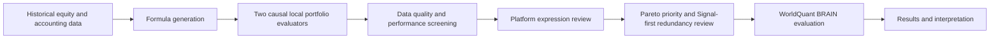

# Programmatic Equity Alpha Discovery

**A reproducible research workflow for formula generation, causal local backtesting, and evaluation on WorldQuant BRAIN.**

Qidian (Martin) Xing · UCLA Anderson, Master of Financial Engineering  
[中文说明](README_CN.md) · [English paper](paper/Research_Paper_Public_EN.pdf) · [中文论文](paper/Research_Paper_Public_CN.pdf) · [Reproduction guide](docs/reproduction.md)

## Research Motivation

An economically plausible factor can perform poorly when its input data, lookback window, signal direction, or portfolio rules change. Exploring these choices manually makes broad comparison difficult. This project uses a bounded formula language to combine market and accounting fields automatically, then evaluates candidates under consistent rules. Economic interpretation motivates subsequent validation.

## Research Approach



The local system preserves historical security identities, monthly universe timing, accounting availability, and exact next-market-day return alignment. Candidate direction is fixed using 2019–2021 information. Selection uses 2022–2024 development statistics. Signal-first review compares signed stock scores and actual positions before deferring redundant candidates.

## Key Results

Frozen completed-cohort evidence through **October 7, 2026**:

| Stage | Candidates | Interpretation |
|---|---:|---|
| Generated and locally evaluated | 20,000 | Both local evaluations completed; includes 48 degenerate outcomes |
| Entered expression review | 10,117 | Gross-performance route; contains the 2,227 cost-route qualifiers |
| Approximately representable | 3,562 | Conditional on reviewed candidates; cross-platform equivalence unproven |
| Retained and validly evaluated | 3,285 | 3,237 new valid results plus 48 matching saved results |
| Recorded non-correlation requirements satisfied | 82 | 2.50% of the retained cohort; correlation and submission assessed separately |

**82 does not mean 82 accepted, independent, correlation-cleared, or submitted alphas.** Among these records, 79 await correlation confirmation, two have explicit self-correlation failures, and one has passing visible checks with production correlation undisplayed. All 40 Pareto layers were completed; 277 candidates were deferred rather than failed.


Earlier layers generally concentrate discoveries, while later layers still contribute passes. [Released aggregates](results/) record definitions and provenance; the papers explain the interpretation.

## Architecture

| Component | Implementation | Responsibility |
|---|---|---|
| Formula Generator | `expressions.py`, `generator.py` | Whitelisted AST, units, bounded operations, seeded generation |
| Local Portfolio Evaluators | `local_first_evaluator.py`, `evaluator.py` | Transparent rank book and SIC2-adjusted book, strict returns and costs |
| Candidate Screening | `screening.py`, `local_first_selection.py` | Fixed data gates, cost/gross routes and reproducible ordering |
| Signal Redundancy | `signal_first.py` | Common-support signed Spearman, final weights and five-objective Pareto layers |
| Platform Results | `results/`, [evidence notes](docs/evidence.md) | Author-created aggregates from saved observations |

The core numerical code is reused from reviewed research implementations. [Provenance and engineering changes](docs/source_provenance.json) distinguish extracted functions, package imports, and portable path adapters. Three [notebooks](notebooks/) walk through data timing, portfolio evaluation, and redundancy using synthetic inputs.

## Reproducibility

Python **3.12 or 3.13**. Install the pinned dependencies in a fresh virtual environment:

```bash
python3 -m venv .venv
source .venv/bin/activate
python -m pip install '.[dev]'
pytest -q
alpha-discovery demo --output artifacts/demo
python scripts/verify_results.py
python scripts/check_internal_links.py --ref HEAD
```

The **Synthetic Demo** generates artificial securities and annual accounts, processes data timing, evaluates eight teaching formulas with the actual dual evaluator, screens candidates, and performs local redundancy comparisons. Its numbers have no market-performance interpretation. No WRDS or BRAIN account is needed.

**Licensed Research Reproduction** accepts researcher-supplied, legally obtained CRSP/Compustat-derived files through an explicit schema and environment configuration. The [guide](docs/reproduction.md) describes required tables, preparation, commands, resource limits and checks. Exact historical candidate-level reconstruction additionally requires the original frozen manifest, retained locally for rights review. BRAIN data and internal implementation cannot be reconstructed offline.

See the [validation record](docs/validation.md) for executed tests and separate statuses for synthetic execution, numerical regression, licensed reconstruction and saved platform evidence. CI runs small offline tests and the synthetic demo.

The [internal link audit](scripts/check_internal_links.py) checks exact path names and committed targets. After an authenticated `git fetch origin main`, run `python scripts/check_internal_links.py --ref HEAD --remote-ref origin/main` to verify the published branch as well.

## Research Paper

- [English research paper, public display adaptation](paper/Research_Paper_Public_EN.pdf)
- [中文研究论文，展示版](paper/Research_Paper_Public_CN.pdf)

These explicitly marked adaptations preserve the completed-cohort conclusions. Candidate expressions, Alpha IDs, individual platform metrics and private evidence references have been removed. The original final PDFs remain in the private research archive. [Adaptation notes](paper/README.md) document the changes.

## Limitations

All 2019–2024 information is development-exposed; **an independent out-of-sample test has not been run**. Local data, industry classification, holdings, costs and expression semantics differ from BRAIN. The 180-day accounting lag is an availability proxy, annual accounts are not vintage histories, and missing returns prevent complete-path statistics. Simplified transaction costs omit market impact, borrowing costs and capacity.

Licensed data, historical candidate registries, platform identifiers, screenshots, credentials and account records are excluded. Repository visibility is initially Private, and no open-source license has been selected. [Distribution review](docs/distribution_review.md) explains the release boundaries and required decisions before a public release.
