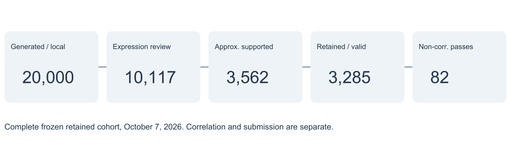
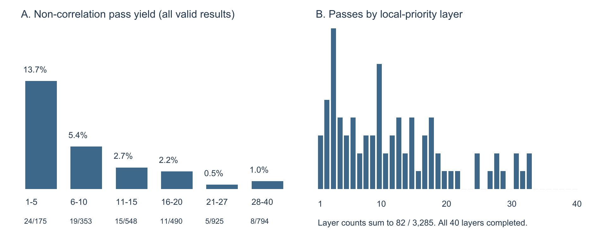

# 从公式生成到平台检验：一种程序化股票因子发现方法

**公开展示改编版：移除真实候选表达式、Alpha ID、单条平台指标和私有证据引用，保留原研究结论与汇总数量。实际公开仍需作者依据适用协议确认。**

**Qidian (Martin) Xing**  
UCLA Anderson · Master of Financial Engineering  
**研究结果截至：2026 年 10 月 7 日**

## 摘要

一个有经济直觉的股票交易想法，未必能产生良好的历史收益；同一个想法采用不同数据和计算方式，也可能得到不同结果。本研究考察一种先搜索、再解释的因子发现方法：让计算机按有限的数学规则组合市场与财务数据，用自建本地回测系统统一评价，再将筛选后的公式放到 WorldQuant BRAIN 检验，最后讨论它们可能反映的经济现象。

研究生成并完成了 20,000 条公式的本地评价。经过数据、表现、平台实现和重复信息审查，3,285 条候选被保留，且全部取得有效平台结果。其中，82 条通过了平台记录的主要表现、交易和组合要求，即全部适用非相关性检查。它们是否与已有 Alpha 过于相似、是否具备正式提交资格，仍需另外判断。本地优先级较高的候选总体更容易通过，但靠后候选也有发现。这说明程序化搜索和本地筛选能够提供有用的研究顺序，并形成有实际平台证据的公式目录；它们的经济机制和未来投资价值仍须进一步检验。

## 1. 研究动机

股票因子研究常从一个经济判断开始，例如近期跌得太多的股票可能反弹，或者盈利质量较高的公司可能获得更好的定价。然而，一个判断合理，并不意味着它的某种具体写法就有良好表现。使用什么数据、回看多长时间、怎样组合指标，甚至把信号取正还是取负，都可能改变结果。要逐一提出、计算并记录成千上万种写法，手动研究很难覆盖充分，也容易让注意力集中在成功案例上。

因此，我们尝试先规定一套有限、透明的公式规则，让计算机系统生成候选，再用统一标准找出值得继续研究的公式。这里的因子或 Alpha，首先是一条给股票评分的计算公式。研究者决定可用的数据、运算和历史窗口，程序负责探索它们的组合。这种分工让我们能够比较大量具体写法，同时保留每条公式的来源和失败结果。

批量生成以后，还需要决定哪些公式值得占用实际平台的测试资源。我们自建本地回测系统，使所有候选先在同一套数据、持仓和收益规则下接受评价，再去除数据不足、表现较弱或信息明显重复的候选。随后，BRAIN 使用自己的数据和规则检验保留公式。先本地、后平台的安排既便于大规模比较，也能发现一条公式离开原来的计算环境后是否仍然有效。

取得结果后，研究还不能停在分数和通过数量上。我们需要看清表现较好的公式究竟在比较什么，以及它们为什么可能与股票收益有关。这样的经济解释是后续验证的起点，而不是由回测自动证明的因果机制。本文据此回答三个问题：能否找到满足平台主要要求的候选？本地排序能否帮助更早发现它们？本地与平台的差异又提示了哪些研究问题？

## 2. 数据基础与信息时间

回测的第一步，是确认过去某一天的一只股票属于哪家公司。股票代码会改变，同一家公司也可能发行不同证券；用今天的代码去连接历史财报，可能把数据配错。研究采用 CRSP 的美国股票日度市场数据和 Compustat 的年度财务报表，以永久证券编号 PERMNO 识别股票，以公司编号 GVKEY 识别财报主体，再用带有效日期的公司—证券连接记录匹配二者。这套连接资料称为 CRSP/Compustat Merged（CCM）数据库。[2]

股票名单也必须按历史时点建立。只使用今天仍存在的公司，会遗漏后来退市或退出市场的股票。我们在每个月最后一个可用市场交易日，按当时可观察到的正市值排序，从符合证券类型和交易所规则的股票中选择最大的 3,000 只，名单从下个月开始生效。这样，月末才知道的规模排名不会决定月初的持仓。这是本地重建的股票池；BRAIN 的 TOP3000 使用平台自己的选择规则。

财报还涉及另一个问题：会计年度结束时，投资者通常尚未拿到完整年报。研究把财报的会计期末字段 `datadate` 加上 180 个日历日，作为允许使用这份数据的日期。在此之前，公式不能读取该报表；在此之后，沿用最近一份已允许使用的报表。如果信号日期距离原会计期末超过 730 天，相应财务字段就设为缺失。730 天从会计期末起算，不是从加过 180 天的日期起算。这些规则明确了本研究如何近似处理信息发布时间。

评价面板有 15 个字段，其中 12 个供主公式生成器使用。除了收益、成交量和市值，还包括盈利、估值、现金流和资产负债比率。比率的分母尤其重要：净利润除以资产衡量资产盈利能力，净利润除以市值则将盈利与市场定价比较。市值由收盘价绝对值乘发行在外股数构造，使用前与报表金额统一单位。财务比率要求分母有效且为正；负盈利和负现金流可以保留，缺失的必要债务项目不能当作零。表 1 给出主要输入，完整字段定义见电子方法补充[3]。

**表 1｜主要数据在公式中比较什么**

| 输入类别 | 代表性计算 | 使用时必须确认的事项 |
|---|---|---|
| 交易与公司规模 | 股票收益、成交量、市值 | 包含与不包含分配的收益不能互换；市值金额单位须一致 |
| 盈利与市场定价 | 净利润/资产、净利润/市值、账面权益/市值 | 不同分母回答不同问题；财报须达到允许使用的日期 |
| 经营与资产负债 | 销售额/资产、经营现金流/资产、债务/资产、现金/资产 | 年度报表沿用时须检查是否过旧；缺失项目不能补零 |

最终本地评价覆盖 2019–2024 年，更早的市场记录用于计算历史窗口和股票池。组合在 t 日收盘形成，只读取截至前一市场日 t−1 的信号，再持有至下一市场日收盘。持仓日和收益终点都须落在统计期间；已持有股票即使退出下一日股票池，其收益仍计入组合。明确谁在什么时间进入持仓，才能把公式分数变成有意义的投资表现。

## 3. 公式生成与本地评价

### 3.1 数据、运算和窗口怎样组成公式

以教学表达式 `rank(ts_mean(returns,5))` 为例：先计算每只股票最近五个观测日的平均日收益，再在当日合格股票中排名。输入、运算和窗口分别记录。该表达式仅说明算法，不作为公开的平台候选。横截面排名比较当日不同股票，时间序列排名比较一只股票自身的历史。

程序按这样的规则组合公式，并限制运算层数、节点数和所用字段数量，避免产生难以解释的巨大表达式。每个公式可以表示成一棵“表达式树”：最底层是数据，上层记录先后执行哪些运算。生成过程使用固定随机种子 20260930，使同一设置下的搜索能够重现。程序也会识别结构重复，例如允许交换顺序的加法不会仅因调换两个输入就算作新公式。23,697 次尝试中有 3,697 次结构重复，最终得到 20,000 条结构唯一的主公式；精确复杂度限制见补充材料。

这些候选包括单字段变换、两个指标的组合、条件判断和参考模板的变体。少量已实现的公开 Alpha101 示例用于比较和启发[1]，但并不是所有主公式的已验证来源。结构唯一也不代表经济信息独立：不同写法仍可能把同一批股票排在前面。本轮程序没有根据回测高分反复修改“父代”公式，而是先生成候选，再交给统一的评价和筛选。

### 3.2 从股票分数到实际多空持仓

公式先回答“更偏好哪只股票”，还没有回答“买卖多少”。信号（signal）是每只股票的分数；权重（weight）是分配给它的多头或空头仓位；组合收益（return）才是这些仓位带来的盈亏。因此，相同的评分公式采用不同的持仓规则，也可能得到不同收益。

我们保留两套本地组合，以观察评分和持仓处理各自的影响。第一套将同一天的股票分数排序，再减去整体平均排名，把股票的高低排名转成多空分数。第二套先用前四个观测按 4:3:2:1 加权，减少单次信号变化的影响；再减去各行业平均分数，进行股票排名，并再次消除行业平均排名差异。行业处理是为了减少分数仅仅反映行业整体差别的情况。本地行业分组采用两位标准行业分类 SIC2；平台的 Subindustry 是另一套行业划分。第二套组合让若干处理更接近目标平台，但并非其精确复制。

接着需要统一持仓规模，避免一条公式仅因分数数值大就承担更多风险。令 \(U_t\) 为有信号支持的合格股票集合，\(s_{i,t}\) 为完成上述处理且方向已固定的分数。目标权重按下式形成：

$$ w_{i,t}=\frac{2s_{i,t}}{\sum_{j\in U_t}|s_{j,t}|},\qquad \sum_i|w_{i,t}|=2,\qquad \sum_iw_{i,t}=0. \tag{1} $$

式（1）按分数的相对大小分配仓位，使多头合计为 1、空头绝对值合计也为 1，总绝对敞口为 2，净敞口为 0。两套组合都要求单只股票绝对权重不超过 0.08；第二套还要求每个行业内净敞口为 0。不满足约束的日期记为无法形成有效权重，不通过裁剪或重新优化仓位来补救。对没有事先指定方向的公式，只用 2019–2021 年本地数据决定一次正负方向，此后固定。

### 3.3 收益、数据缺失和假设交易成本

有了 t 日收盘持仓，才可以计算它在下一市场日赚亏多少。令 \(H_t\) 为非零持仓股票集合，将每只股票从 t 日收盘至下一市场日收盘的收益与其持仓权重相乘，再求和：

$$ R^{\mathrm{gross}}_{t+1}=\sum_{i\in H_t}w_{i,t}r_{i,t\to t+1}. \tag{2} $$

式（2）是组合未扣交易成本的毛收益。多头股票上涨会贡献正收益，空头股票下跌也会贡献正收益。如果任何一只实际持有的股票缺少对应的下一日收益，我们就无法确定整日组合收益，将该日记为不可观测。研究既不把缺失收益填成零，也不根据事后看到的缺失情况重新分配此前确定的仓位。

评价还要考虑收益波动和交易频率。Sharpe 比率用平均日收益相对于日收益波动的大小衡量表现，并按 252 个交易日年化；最大回撤描述收益路径从此前高点下跌的最大幅度。换手率（turnover）衡量目标持仓改变了多少。研究分别假设每边 0、5 和 10 个基点的交易成本，1 个基点等于 0.01%，从毛收益中扣除与持仓变化对应的成本后得到净收益。这样可以识别依赖频繁交易的公式。严格换手和成本计算，以及毛、净收益各自的有效日期范围，均保留在补充材料中。

## 4. 候选筛选与平台实现

### 4.1 为什么先检查数据，再比较表现

一条公式偶尔得到很高收益，可能只是因为它只有少数日期或股票可用。我们先检查它能否经常给足够多的股票评分、形成有效权重，以及取得实际持仓的下一日收益。其中，已定义持仓的严格次日收益须至少在 95% 的日期可观测；其他覆盖门槛见补充材料。20,000 条公式都完成了两套本地计算，19,952 条形成正常评价记录，48 条则因信号或组合退化而无法支持常规表现评价。这 48 条有明确计算结果，并非漏测。

数据足够以后，我们依据 2022–2024 年开发期统计，采用两条质量路线。第一条重视成本后的表现：毛收益均值和扣除每边 5 基点后的净收益均值都须为正，且至少两个开发年度净收益均值为正，有 2,227 条符合。第二条先看未扣费表现：毛收益均值和毛 Sharpe 为正，且至少两个开发年度毛收益均值为正，有 10,117 条符合。保留第二条路线，是为了避免本地简化成本过早排除在目标平台上仍可能有效的公式。实际结果中，2,227 条全部包含在 10,117 条内，因此下一步审查的是 10,117 条，而不是二者之和。

### 4.2 本地能运行，为什么平台未必能运行

本地计算机能够运行一个因子公式，并不代表 WorldQuant BRAIN 也能够计算同样的东西。我们需要检查三个问题：平台有没有定义一致的数据？它能否执行公式要求的计算？即使公式能写出来，两边对历史窗口、时间和缺失值的处理是否仍有差别？这项检查称为平台可表达性审查，目的是确认目前有没有可靠的平台写法。

例如，包含股息等分配的股票收益，不能直接替代不包含分配的收益；计算账面权益/市值时，两项金额也必须采用一致单位。另一些公式需要过去较长时期的最小值或最大值，不能因为平台能算均值，就认为它必然允许所需的极值运算。条件公式还要确认：条件本身缺失时，输出也是缺失，还是会进入某个分支？这些具体问题决定了平台公式是否仍在比较原来的东西。

在进入审查的 10,117 条中，3,562 条可以转换成目前有证据支持的近似平台表达式；6,555 条因上述数据或计算问题，尚未获得可靠实现证据。最初 20,000 条中的另外 9,883 条没有进入这轮审查，其平台可表达性仍未知。“暂时没有可靠写法”不等于数学上永远无法表达；“能在 BRAIN 上表达”也不等于两边计算完全一致，更不等于已经通过表现检查。这个区分使我们能够继续研究受阻公式，同时准确说明已运行公式的含义。

### 4.3 候选各有优势，怎样决定先测试谁

假设两个候选中，A 的整体 Sharpe 更高，却有一个年度表现很差；B 的整体 Sharpe 稍低，但各年更稳定。仅按 Sharpe 选第一名，会忽略 B 的优势。因此，我们同时比较 2022–2024 年开发期的整体毛 Sharpe、年度 Sharpe 中位数、最差年度 Sharpe、最大回撤，以及综合收益和换手的本地 Fitness。

本地 Fitness 的作用，是在比较收益质量时同时考虑收益规模和交易频率。它采用与平台相同的函数形式，但代入本地计算的数值：

$$ F_{\mathrm{local}}=S_{\mathrm{local}}\sqrt{\frac{|252\,\overline{R}^{\mathrm{gross}}|}{\max(\overline{T},0.125)}}. \tag{3} $$

式（3）中，\(S_{\mathrm{local}}\) 是年化毛 Sharpe，上横线分别表示日毛收益和目标权重换手的样本均值，收益与换手均用小数比例。252 将日均毛收益换成年化尺度，0.125 给分母设置下限，避免极低换手使指标失去比较意义。它用于本地排序，不能代替 BRAIN 实际计算的官方 Fitness。

有了五个指标，我们采用 Pareto 分层决定优先顺序。如果 A 在五项上都不差于 B，且至少一项更好，B 就被 A 全面压过；若两者各有优势，则不强行判定谁更好。没有被其他候选全面压过的公式组成第一层，取走它们后，对剩余公式重复这一步，得到第二层，直至形成 40 层。比较回撤时，损失越小越好。这里的层数安排测试先后，不是对后层公式的正式淘汰。

### 4.4 为什么收益相似，还要比较选股和持仓

两条组合收益同时涨跌，不一定意味着它们选择了同样的股票。例如，一条偏好某类公司，另一条投资不同公司，仍可能受共同市场变化影响。如果仅凭历史组合收益的相似程度去重，就可能丢掉不同的选股信息。因此，最终方法先看股票评分，再核对实际持仓，这一顺序称为 Signal-first。

信号相似度问的是：两条公式是否经常把相同股票排在前面和后面？权重相似度进一步问：它们是否在相同日期持有相同股票，并分配近似的多空仓位？程序先用 2019–2023 年固定日期的分数快照找到疑似重复者，再比较共同股票上的逐日有方向排名、归一化持仓差异和有效日期。相反方向的股票排序不会仅因绝对相关性高就被合并。只有选股和持仓证据充分，且新候选没有更好的质量指标，才暂缓重复测试；证据不足则保留。

这一步从 3,562 条中保留了 3,285 条，另 277 条延期，并记录各自对应的优先代表。延期是可恢复的测试安排，不是删除公式，也不是平台失败。保留候选的表达式、方向、窗口和平台设置在运行前固定；已有结果只有在公式身份和设置确实匹配时才复用。至此，平台测试对象既经过质量审查，也尽量减少了信息明确重复的测试。

## 5. 实际平台结果与案例

### 5.1 最终发现了什么，数量为何逐步减少

研究最终找到 82 条通过全部适用非相关性检查的候选。简要地说，它们通过了平台记录的主要表现、交易和组合要求：收益相对于波动达到要求，收益与换手的综合表现合格，交易频率在规定范围内，仓位没有过度集中，并满足较小股票池的表现检查和适用赛制要求。相关性与正式提交另行判断。完整的七项检查名称及适用规则见补充材料。

这 82 条来自全部 3,285 条保留候选的有效平台结果，通过比例约为 2.50%。其中，3,237 条是本次新增的有效评价，48 条复用此前相同表达式和设置的记录，后者不算新的模拟。平台采用美国 TOP3000、一天信号延迟、四期衰减及 Subindustry 行业处理等固定设置；精确参数见补充材料。表 2 将每次缩小的原因和结果分开说明。

**表 2｜从全部本地公式到平台检查通过候选**

| 研究步骤 | 实际数量 | 为什么得到这个数量 |
|---|---:|---|
| 生成并完成本地评价 | 20,000 | 所有主公式均完成两套本地评价 |
| 进入平台表达审查 | 10,117 | 满足毛表现质量路线；包含 2,227 条成本路线通过者 |
| 有证据支持的近似平台写法 | 3,562 | 6,555 条当前缺少可靠实现；9,883 条未接受本次审查 |
| 保留进入平台评价 | 3,285 | 277 条因重复信息证据延期，仍可恢复 |
| 取得有效平台结果 | 3,285 | 3,237 条新结果，加 48 条匹配的历史记录 |
| 通过适用非相关性检查 | 82 | 82/3,285≈2.50%；相关性与提交仍须分别判断 |

保留候选已经全部评价，因而 82 条不是只完成部分测试时得到的暂时数量。与此同时，只有少部分本地候选通过平台主要要求，说明本地筛选能够选择测试对象，却不能提前保证成功。下面考察它是否至少能把更有希望的对象排在前面。

### 5.2 本地优先顺序是否有用

将 40 个本地优先层分为六组，较前候选总体更容易通过。第 1–5 层通过 24/175 条（13.71%），第 6–10 层为 19/353（5.38%），第 11–15 层为 15/548（2.74%），第 16–20 层为 11/490（2.24%），第 21–27 层为 5/925（0.54%），第 28–40 层为 8/794（1.01%）。图 2 展示六个优先级分组的完整队列通过率及 40 个层分别发现的数量。展示版以层级汇总代替原始候选顺序累计图。

这种关系并非每往后一层就变差：第 28–40 层的比例高于第 21–27 层，有些未发现通过者的层之后仍有新发现。最后出现通过者的是第 33 层；第 34–40 层的 139 条有效结果没有通过者。它描述的是本次候选池，不能据此规定今后永远在某一层停止。

研究曾在资源暂停时留下 709 条未测，后来按原先确定的顺序补完，额外找到 8 条通过者。这说明后段测试虽然总体产出较低，仍有实际价值。本地排序提供的是分配测试资源的依据；公式是否满足平台要求，仍需实际结果确认。

### 5.3 未公开的候选明细

原始私有论文包含四个案例的真实表达式、Alpha ID 与单条平台指标。这些材料的分发权尚未确认，因此展示版不包含相关明细。汇总结论保持不变：本地扣费表现与目标平台检查可能不一致，本地优先级最高的候选也可能未通过平台要求。

## 6. 讨论与结论

研究得到了三个具体答案。第一，有限的数据和运算规则足以生成大量可评价的股票公式，并从中找到 82 条有平台主要检查通过证据的候选。第二，本地优先顺序能提高前段测试的发现比例，但没有排除后段发现。第三，本地与平台的差异确实影响结果：本地成本后表现较弱的候选可能在平台通过，本地第一名也可能失败。因此，这套方法的成果是可追溯的搜索过程、有效的测试顺序和待继续验证的公式目录。

这些成果有三项核心限制。全部 2019–2024 年本地信息曾在开发中被接触，早期平台结果也影响过方法修订，所以最终冻结的评价不能称为完全未见数据上的独立检验。其次，本地与平台的数据、股票池、行业分组、持仓规则和精确日期不同，近似平台写法也不保证逐项计算相同。最后，180 天财报时间只是代理，部分本地收益只在完整可观测日期上统计，简化成本未覆盖真实市场冲击、借券和容量。现有表现因此尚不能证明未来可交易盈利。

82 条也不等于 82 个独立且具备最终提交资格的 Alpha。平台还会检查因子收益与其他 Alpha 是否过于相似；这种收益相关性判断不同于本地对股票排序和持仓的重复信息审查。保存记录中，79 条相关性待确认，2 条已明确未通过平台的 self-correlation 项；另 1 条可见适用检查通过，但 production correlation 项没有显示。候选级提交记录不在本展示版公开。[3] 本研究报告的是已经观察到的阶段性成果，后续仍须检验独立性和样本外表现。

## 7. 后续研究

首先，应找出哪些受阻公式缺少对应数据、哪些需要平台尚未确认支持的计算、哪些在两边有不同的时间窗口或缺失值处理。缺数据时，寻找定义一致的字段并核对金额单位和信息日期；缺计算时，用已知输入的小例子验证平台能否执行；处理规则不同时，逐项比较两边输出。只有原有数学含义得到保持，新的平台写法才算同一公式的实现，否则应登记为新候选。另有 9,883 条尚未接受平台表达审查，可以单独审查，但能运行与值得测试仍是两个问题。

其次，应改进数据时间并解释表现差异。使用真实公告日期和历史报表版本，可检验固定 180 天代理是否改变选股；将证券、市场日期、行业分组和逐日持仓逐项对齐，可分别识别数据与组合规则带来的影响。每项改进都应与原来冻结的结果比较，说明它解决了什么，而不是只观察最终分数是否提高。

最后，应先冻结候选和评价办法，再在未参与开发的新时期检验表现，同时完成实际平台收益相关性检查和更现实的成本分析。这样才能判断已有发现是否延续，是否提供了不同于其他 Alpha 的信息，以及扣除可实现交易成本后是否仍有价值。下一阶段的重点，是把已有历史证据转化为更可靠的投资判断。

## 参考文献

[1] Kakushadze, Z. (2016). *101 Formulaic Alphas*. *Wilmott*, 2016(84), 72–80. https://arxiv.org/abs/1601.00991.

[2] Morningstar/CRSP. *CRSP/Compustat Merged (CCM) Database*. 永久证券标识与公司—证券历史连接的官方资料。https://indexes.morningstar.com/research-data-products/crsp-compustat-merged-database。访问日期：2026-10-08。

[3] Xing, Q. (2026). Programmatic Equity Alpha Discovery：仓库中的汇总结果与本地方法，见 results/ 和 docs/。完整私有补充材料包含未公开的候选明细。
